# 🃏 As 63 cartas do PyJutsu

Cada dia tem três cartas, uma por nível. Conquiste a carta quando terminar o exercício.

| Nível | Cartas | Rank |
|---|---|---|
| 1 · Original (cipher387) | 1–21 | D (dias 1–10) · C (11–21) |
| 2 · Camada Brasil | 22–42 | B (dias 1–10) · A (11–21) |
| 3 · Desafio | 43–63 | S |

## Arco I · Fundamentos

| Carta | Nº | Rank | Nome | Dia | Efeito |
|---|---|---|---|---|---|
|  | 1 | D | [Jutsu do Primeiro Sinal](dia-01-primeiro-script/original/start.py) | [01](dia-01-primeiro-script/) | Faz o Python falar pela primeira vez com um único print(). |
| 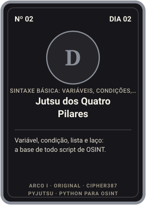 | 2 | D | [Jutsu dos Quatro Pilares](dia-02-sintaxe-basica/original/variable.py) | [02](dia-02-sintaxe-basica/) | Variável, condição, lista e laço: a base de todo script de OSINT. |
| 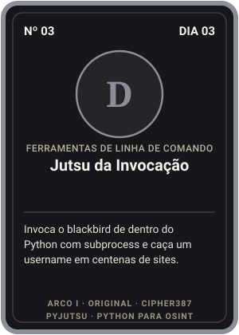 | 3 | D | [Jutsu da Invocação](dia-03-ferramentas-de-linha-de-comando/original/launch.py) | [03](dia-03-ferramentas-de-linha-de-comando/) | Invoca o blackbird de dentro do Python com subprocess e caça um username em centenas de sites. |
|  | 4 | D | [Jutsu do Pergaminho](dia-04-arquivos/original/read_file.py) | [04](dia-04-arquivos/) | Lê e escreve arquivos de texto com open(), read(), readlines() e write(). |
|  | 5 | D | [Jutsu do Primeiro Pedido](dia-05-http-e-apis/original/api_request.py) | [05](dia-05-http-e-apis/) | Faz um GET na API de busca do GitHub com requests e mostra a resposta JSON inteira. |
| 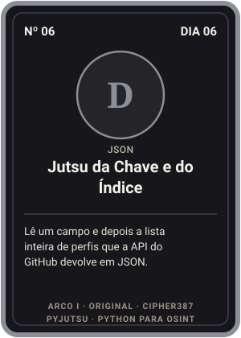 | 6 | D | [Jutsu da Chave e do Índice](dia-06-json/original/read_list_of_fields.py) | [06](dia-06-json/) | Lê um campo e depois a lista inteira de perfis que a API do GitHub devolve em JSON. |
| 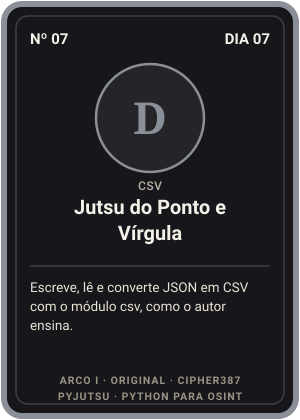 | 7 | D | [Jutsu do Ponto e Vírgula](dia-07-csv/original/json_to_csv.py) | [07](dia-07-csv/) | Escreve, lê e converte JSON em CSV com o módulo csv, como o autor ensina. |
| 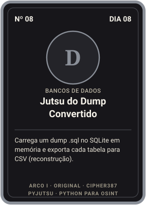 | 8 | D | [Jutsu do Dump Convertido](dia-08-bancos-de-dados/original/nivel1_sql_para_csv.py) | [08](dia-08-bancos-de-dados/) | Carrega um dump .sql no SQLite em memória e exporta cada tabela para CSV (reconstrução). |
| 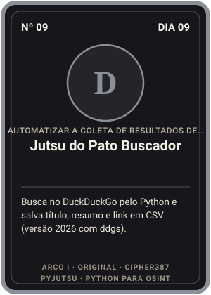 | 9 | D | [Jutsu do Pato Buscador](dia-09-resultados-de-busca/original/2026_ddg_search_to_csv.py) | [09](dia-09-resultados-de-busca/) | Busca no DuckDuckGo pelo Python e salva título, resumo e link em CSV (versão 2026 com ddgs). |
|  | 10 | D | [Jutsu da Sopa de Tags](dia-10-scraping/original/scraping.py) | [10](dia-10-scraping/) | Baixa uma página e captura o título h1 com requests e BeautifulSoup. |
|  | 11 | C | [Jutsu da Arroba](dia-11-regex/original/extract_emails.py) | [11](dia-11-regex/) | Baixa uma página e extrai tudo o que tem formato de e-mail com re.findall. |
|  | 12 | C | [Jutsu do Embaixador](dia-12-proxies/original/simple_proxy.py) | [12](dia-12-proxies/) | Envia pedidos por um proxy, testa uma lista deles e troca o User-Agent com requests. |
|  | 13 | C | [Jutsu da Fila](dia-13-listas/original/array_sort.py) | [13](dia-13-listas/) | Copia, ordena, insere, acrescenta e remove itens de uma lista de cidades. |
|  | 14 | C | [Jutsu do Arquivista](dia-14-sistema-de-arquivos/original/check_re_files_contents.py) | [14](dia-14-sistema-de-arquivos/) | Lista arquivos com glob, lê o conteúdo e acha os que contêm um texto ou um e-mail. |
|  | 15 | C | [Jutsu do Registro](dia-15-dominios/original/whois_info.py) | [15](dia-15-dominios/) | Revela o IP e o WHOIS de qualquer domínio com dnspython e python-whois. |
|  | 16 | C | [Jutsu do Mapa](dia-16-map-e-strings/original/array_map.py) | [16](dia-16-map-e-strings/) | Aplica uma função em cada item de uma lista com map(): title, capitalize, replace e split. |
|  | 17 | C | [Jutsu dos Três Papéis](dia-17-documentos/original/create_docx.py) | [17](dia-17-documentos/) | Gera planilha XLSX, documento DOCX e PDF com imagem usando XlsxWriter, python-docx e fpdf2. |
|  | 18 | C | [Jutsu do Pincel](dia-18-graficos-e-mapas/original/bar.py) | [18](dia-18-graficos-e-mapas/) | Desenha gráfico de barras com matplotlib e mapa-múndi com Basemap (ou folium, na versão 2026). |
| 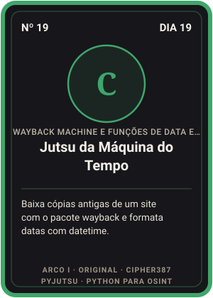 | 19 | C | [Jutsu da Máquina do Tempo](dia-19-wayback-e-datas/original/download_mementos.py) | [19](dia-19-wayback-e-datas/) | Baixa cópias antigas de um site com o pacote wayback e formata datas com datetime. |
|  | 20 | C | [Jutsu da Vitrine Própria](dia-20-web-apps/original/webapp.py) | [20](dia-20-web-apps/) | Transforma um script em página web com caixa de texto e botão usando Streamlit. |
| 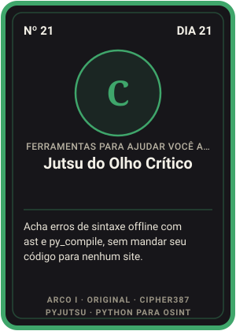 | 21 | C | [Jutsu do Olho Crítico](dia-21-ferramentas-de-codigo/original/nivel1_checar_sintaxe.py) | [21](dia-21-ferramentas-de-codigo/) | Acha erros de sintaxe offline com ast e py_compile, sem mandar seu código para nenhum site. |

## Arco II · Brasil

| Carta | Nº | Rank | Nome | Dia | Efeito |
|---|---|---|---|---|---|
|  | 22 | B | [Jutsu do Primeiro Alerta](dia-01-primeiro-script/br/01_ola_nfa.py) | [01](dia-01-primeiro-script/) | f-strings, emojis e a hora certa de Brasília: o briefing do caso na tela. |
| 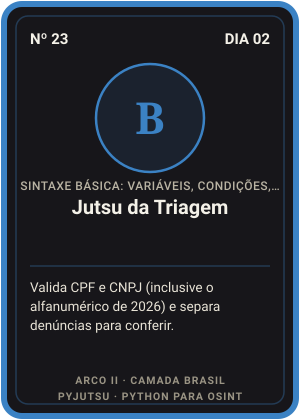 | 23 | B | [Jutsu da Triagem](dia-02-sintaxe-basica/br/02_valida_cpf.py) | [02](dia-02-sintaxe-basica/) | Valida CPF e CNPJ (inclusive o alfanumérico de 2026) e separa denúncias para conferir. |
| 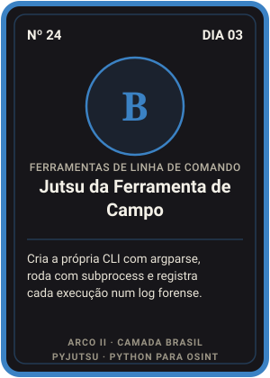 | 24 | B | [Jutsu da Ferramenta de Campo](dia-03-ferramentas-de-linha-de-comando/br/01_cli_cep.py) | [03](dia-03-ferramentas-de-linha-de-comando/) | Cria a própria CLI com argparse, roda com subprocess e registra cada execução num log forense. |
| 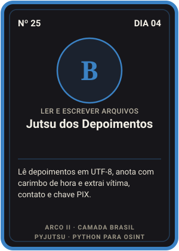 | 25 | B | [Jutsu dos Depoimentos](dia-04-arquivos/br/01_ler_depoimentos.py) | [04](dia-04-arquivos/) | Lê depoimentos em UTF-8, anota com carimbo de hora e extrai vítima, contato e chave PIX. |
| 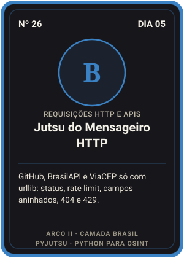 | 26 | B | [Jutsu do Mensageiro HTTP](dia-05-http-e-apis/br/01_github_stdlib.py) | [05](dia-05-http-e-apis/) | GitHub, BrasilAPI e ViaCEP só com urllib: status, rate limit, campos aninhados, 404 e 429. |
| 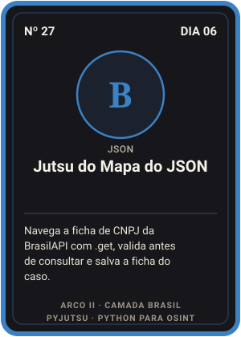 | 27 | B | [Jutsu do Mapa do JSON](dia-06-json/br/01_cnpj_brasilapi.py) | [06](dia-06-json/) | Navega a ficha de CNPJ da BrasilAPI com .get, valida antes de consultar e salva a ficha do caso. |
|  | 28 | B | [Jutsu da Planilha Viva](dia-07-csv/br/01_ler_denuncias.py) | [07](dia-07-csv/) | DictReader com ';', soma com Decimal, municípios do IBGE em CSV e cidades padronizadas com difflib. |
|  | 29 | B | [Jutsu do Arquivo Morto](dia-08-bancos-de-dados/br/02_quem_recebeu.py) | [08](dia-08-bancos-de-dados/) | Explora tabelas com sqlite_master, faz JOIN e GROUP BY nas contas laranja e consulta com '?'. |
| 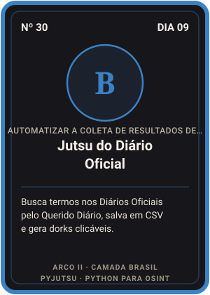 | 30 | B | [Jutsu do Diário Oficial](dia-09-resultados-de-busca/br/01_querido_diario.py) | [09](dia-09-resultados-de-busca/) | Busca termos nos Diários Oficiais pelo Querido Diário, salva em CSV e gera dorks clicáveis. |
|  | 31 | B | [Jutsu da Vitrine Congelada](dia-10-scraping/br/01_html_parser_vitrine.py) | [10](dia-10-scraping/) | Raspa a cópia salva da loja com html.parser: preços, PIX, CNPJ, links e comentários escondidos. |
|  | 32 | A | [Jutsu do Padrão Brasileiro](dia-11-regex/br/01_padroes_br.py) | [11](dia-11-regex/) | Regex de CPF, CNPJ alfanumérico, telefone, CEP, placa e PIX, confirmadas por dígito verificador. |
|  | 33 | A | [Jutsu do Disfarce Digital](dia-12-proxies/br/01_meu_ip.py) | [12](dia-12-proxies/) | Mostra o IP e os cabeçalhos que você revela, usa ProxyHandler e roda um checklist de OPSEC. |
|  | 34 | A | [Jutsu da Lista Ordenada](dia-13-listas/br/02_ordenar_com_acento.py) | [13](dia-13-listas/) | Ordena com acento, tira repetidos mantendo a ordem, faz ranking e compara meses com conjuntos. |
|  | 35 | A | [Jutsu da Sala de Evidências](dia-14-sistema-de-arquivos/br/03_hash_custodia.py) | [14](dia-14-sistema-de-arquivos/) | Varre pastas com pathlib, acha PIX e e-mails em tudo e lacra cada arquivo com SHA-256. |
|  | 36 | A | [Jutsu do Registro Estruturado](dia-15-dominios/br/01_rdap_br.py) | [15](dia-15-dominios/) | RDAP + WHOIS porta 43 + DNS sobre HTTPS, só com stdlib. Funciona no registro.br. |
|  | 37 | A | [Jutsu dos Muitos Nomes](dia-16-map-e-strings/br/03_variantes_username.py) | [16](dia-16-map-e-strings/) | Corrige nomes BR, tira acentos e gera centenas de variantes de username a partir de um nome. |
|  | 38 | A | [Jutsu do Relatório Automático](dia-17-documentos/br/02_relatorio_html.py) | [17](dia-17-documentos/) | Relatório em Markdown, HTML com hashes e CSV para Excel pt-BR, só com stdlib. Bônus: PDF na unha. |
|  | 39 | A | [Jutsu do Mapa das Vítimas](dia-18-graficos-e-mapas/br/03_mapa_leaflet.py) | [18](dia-18-graficos-e-mapas/) | Barras no terminal, gráfico SVG e mapa Leaflet com círculos proporcionais, tudo gerado com stdlib. |
|  | 40 | A | [Jutsu da Linha do Tempo](dia-19-wayback-e-datas/br/03_linha_do_tempo_caso.py) | [19](dia-19-wayback-e-datas/) | API CDX sem pip, datas com fuso de Brasília e a linha do tempo do golpe com o efeito Black Friday. |
| 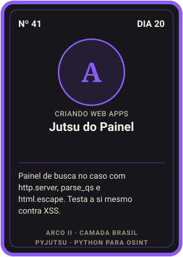 | 41 | A | [Jutsu do Painel](dia-20-web-apps/br/02_painel_do_caso.py) | [20](dia-20-web-apps/) | Painel de busca no caso com http.server, parse_qs e html.escape. Testa a si mesmo contra XSS. |
| 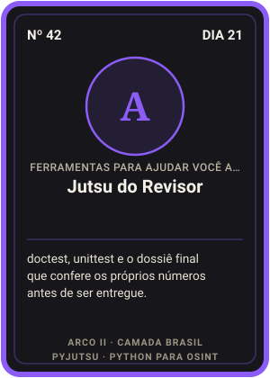 | 42 | A | [Jutsu do Revisor](dia-21-ferramentas-de-codigo/br/03_dossie_final.py) | [21](dia-21-ferramentas-de-codigo/) | doctest, unittest e o dossiê final que confere os próprios números antes de ser entregue. |

## Arco III · Mestria

| Carta | Nº | Rank | Nome | Dia | Efeito |
|---|---|---|---|---|---|
|  | 43 | S | [Boletim de Plantão](dia-01-primeiro-script/desafio.md) | [01](dia-01-primeiro-script/) | Gera o boletim do turno com carimbo de hora, dias de golpe e R$ no formato brasileiro. |
| 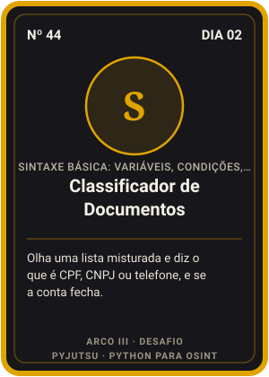 | 44 | S | [Classificador de Documentos](dia-02-sintaxe-basica/desafio.md) | [02](dia-02-sintaxe-basica/) | Olha uma lista misturada e diz o que é CPF, CNPJ ou telefone, e se a conta fecha. |
| 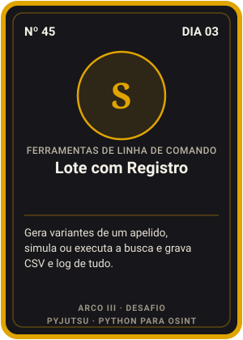 | 45 | S | [Lote com Registro](dia-03-ferramentas-de-linha-de-comando/desafio.md) | [03](dia-03-ferramentas-de-linha-de-comando/) | Gera variantes de um apelido, simula ou executa a busca e grava CSV e log de tudo. |
| 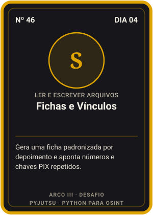 | 46 | S | [Fichas e Vínculos](dia-04-arquivos/desafio.md) | [04](dia-04-arquivos/) | Gera uma ficha padronizada por depoimento e aponta números e chaves PIX repetidos. |
| 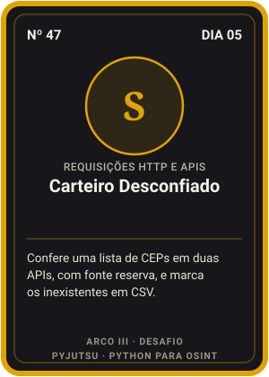 | 47 | S | [Carteiro Desconfiado](dia-05-http-e-apis/desafio.md) | [05](dia-05-http-e-apis/) | Confere uma lista de CEPs em duas APIs, com fonte reserva, e marca os inexistentes em CSV. |
| 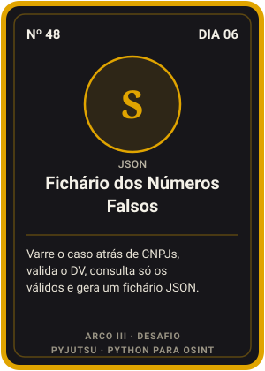 | 48 | S | [Fichário dos Números Falsos](dia-06-json/desafio.md) | [06](dia-06-json/) | Varre o caso atrás de CNPJs, valida o DV, consulta só os válidos e gera um fichário JSON. |
| 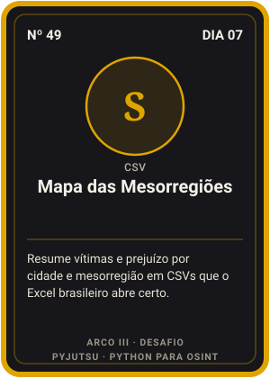 | 49 | S | [Mapa das Mesorregiões](dia-07-csv/desafio.md) | [07](dia-07-csv/) | Resume vítimas e prejuízo por cidade e mesorregião em CSVs que o Excel brasileiro abre certo. |
| 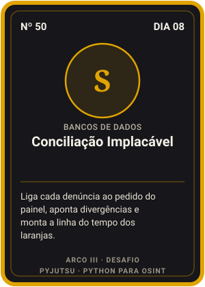 | 50 | S | [Conciliação Implacável](dia-08-bancos-de-dados/desafio.md) | [08](dia-08-bancos-de-dados/) | Liga cada denúncia ao pedido do painel, aponta divergências e monta a linha do tempo dos laranjas. |
| 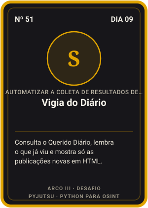 | 51 | S | [Vigia do Diário](dia-09-resultados-de-busca/desafio.md) | [09](dia-09-resultados-de-busca/) | Consulta o Querido Diário, lembra o que já viu e mostra só as publicações novas em HTML. |
|  | 52 | S | [Caçador de Lojas Irmãs](dia-10-scraping/desafio.md) | [10](dia-10-scraping/) | Compara impressões digitais de páginas (generator, PIX, WhatsApp, e-mail) e aponta lojas da mesma origem. |
|  | 53 | S | [O Elo Telefônico](dia-11-regex/desafio.md) | [11](dia-11-regex/) | Normaliza telefones de todas as fontes do caso e revela o número que liga site, conversa e vítimas. |
|  | 54 | S | [Peneira de Proxies](dia-12-proxies/desafio.md) | [12](dia-12-proxies/) | Classifica proxies em morto, transparente, anônimo ou elite e mede a latência de cada um. |
|  | 55 | S | [Fila de Diligências](dia-13-listas/desafio.md) | [13](dia-13-listas/) | Agrupa denúncias por chave PIX, soma o prejuízo e ordena por onde a investigação deve começar. |
|  | 56 | S | [Triagem do Pendrive](dia-14-sistema-de-arquivos/desafio.md) | [14](dia-14-sistema-de-arquivos/) | Desmascara extensões falsas, duplicatas e arquivos já conhecidos usando hash e números mágicos. |
|  | 57 | S | [Radar do Recém-Nascido](dia-15-dominios/desafio.md) | [15](dia-15-dominios/) | Varre uma lista de domínios e aponta os criados há menos de 90 dias. |
|  | 58 | S | [Olho das Grafias](dia-16-map-e-strings/desafio.md) | [16](dia-16-map-e-strings/) | Decide se duas grafias podem ser a mesma pessoa, aceitando acentos e iniciais abreviadas. |
|  | 59 | S | [Fábrica de Ofícios](dia-17-documentos/desafio.md) | [17](dia-17-documentos/) | Um modelo, N ofícios: um por instituição de pagamento, com as transações e um índice com SHA-256. |
|  | 60 | S | [Cartógrafo Offline](dia-18-graficos-e-mapas/desafio.md) | [18](dia-18-graficos-e-mapas/) | Projeta lat/lon em SVG sem internet e mede a distância de cada vítima ao endereço falso (haversine). |
| 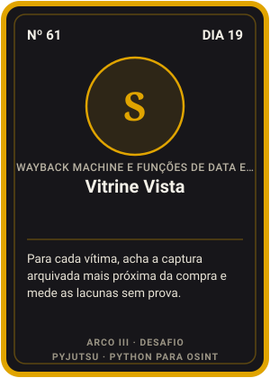 | 61 | S | [Vitrine Vista](dia-19-wayback-e-datas/desafio.md) | [19](dia-19-wayback-e-datas/) | Para cada vítima, acha a captura arquivada mais próxima da compra e mede as lacunas sem prova. |
| 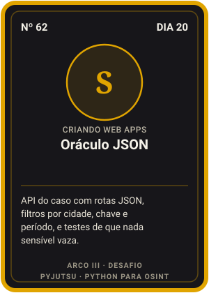 | 62 | S | [Oráculo JSON](dia-20-web-apps/desafio.md) | [20](dia-20-web-apps/) | API do caso com rotas JSON, filtros por cidade, chave e período, e testes de que nada sensível vaza. |
| 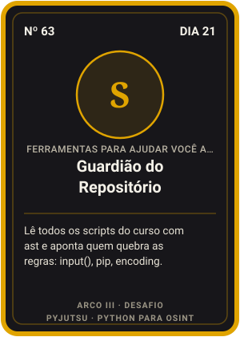 | 63 | S | [Guardião do Repositório](dia-21-ferramentas-de-codigo/desafio.md) | [21](dia-21-ferramentas-de-codigo/) | Lê todos os scripts do curso com ast e aponta quem quebra as regras: input(), pip, encoding. |
