# 🃏 As 63 cartas do PyJutsu

Cada dia tem três cartas, uma por nível. Conquiste a carta quando terminar o exercício.

| Nível | Cartas | Rank |
|---|---|---|
| 1 · Original (cipher387) | 1–21 | D (dias 1–10) · C (11–21) |
| 2 · Camada Brasil | 22–42 | B (dias 1–10) · A (11–21) |
| 3 · Desafio | 43–63 | S |

## Arco I · Fundamentos

| Carta | Nº | Rank | Nome | Dia | Efeito |
|---|---|---|---|---|---|
| 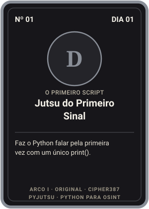 | 1 | D | [Jutsu do Primeiro Sinal](dia-01-primeiro-script/original/start.py) | [01](dia-01-primeiro-script/) | Faz o Python falar pela primeira vez com um único print(). |
| 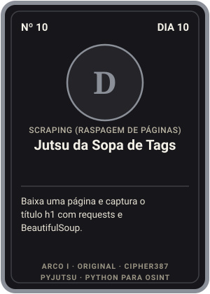 | 10 | D | [Jutsu da Sopa de Tags](dia-10-scraping/original/scraping.py) | [10](dia-10-scraping/) | Baixa uma página e captura o título h1 com requests e BeautifulSoup. |
| 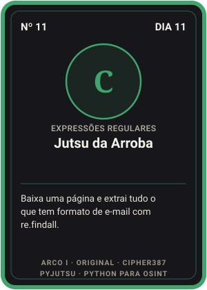 | 11 | C | [Jutsu da Arroba](dia-11-regex/original/extract_emails.py) | [11](dia-11-regex/) | Baixa uma página e extrai tudo o que tem formato de e-mail com re.findall. |
| 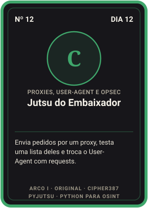 | 12 | C | [Jutsu do Embaixador](dia-12-proxies/original/simple_proxy.py) | [12](dia-12-proxies/) | Envia pedidos por um proxy, testa uma lista deles e troca o User-Agent com requests. |
| 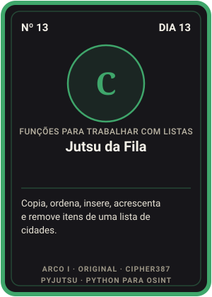 | 13 | C | [Jutsu da Fila](dia-13-listas/original/array_sort.py) | [13](dia-13-listas/) | Copia, ordena, insere, acrescenta e remove itens de uma lista de cidades. |
| 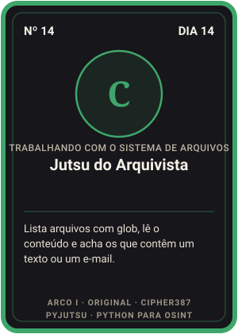 | 14 | C | [Jutsu do Arquivista](dia-14-sistema-de-arquivos/original/check_re_files_contents.py) | [14](dia-14-sistema-de-arquivos/) | Lista arquivos com glob, lê o conteúdo e acha os que contêm um texto ou um e-mail. |
| 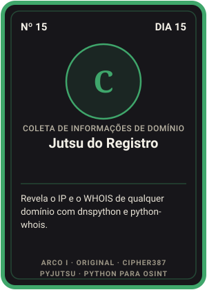 | 15 | C | [Jutsu do Registro](dia-15-dominios/original/whois_info.py) | [15](dia-15-dominios/) | Revela o IP e o WHOIS de qualquer domínio com dnspython e python-whois. |
| 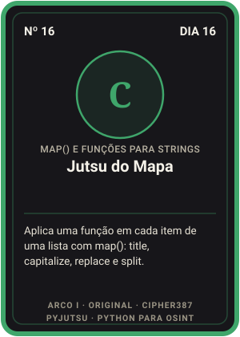 | 16 | C | [Jutsu do Mapa](dia-16-map-e-strings/original/array_map.py) | [16](dia-16-map-e-strings/) | Aplica uma função em cada item de uma lista com map(): title, capitalize, replace e split. |
|  | 17 | C | [Jutsu dos Três Papéis](dia-17-documentos/original/create_docx.py) | [17](dia-17-documentos/) | Gera planilha XLSX, documento DOCX e PDF com imagem usando XlsxWriter, python-docx e fpdf2. |
| 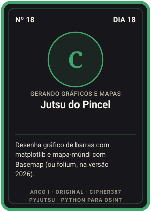 | 18 | C | [Jutsu do Pincel](dia-18-graficos-e-mapas/original/bar.py) | [18](dia-18-graficos-e-mapas/) | Desenha gráfico de barras com matplotlib e mapa-múndi com Basemap (ou folium, na versão 2026). |

## Arco II · Brasil

| Carta | Nº | Rank | Nome | Dia | Efeito |
|---|---|---|---|---|---|
| 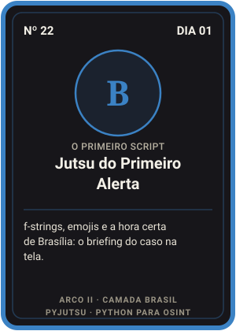 | 22 | B | [Jutsu do Primeiro Alerta](dia-01-primeiro-script/br/01_ola_nfa.py) | [01](dia-01-primeiro-script/) | f-strings, emojis e a hora certa de Brasília: o briefing do caso na tela. |
| 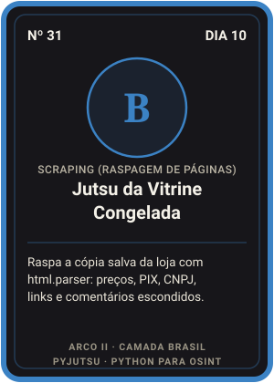 | 31 | B | [Jutsu da Vitrine Congelada](dia-10-scraping/br/01_html_parser_vitrine.py) | [10](dia-10-scraping/) | Raspa a cópia salva da loja com html.parser: preços, PIX, CNPJ, links e comentários escondidos. |
| 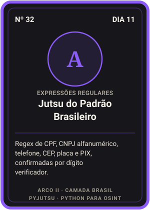 | 32 | A | [Jutsu do Padrão Brasileiro](dia-11-regex/br/01_padroes_br.py) | [11](dia-11-regex/) | Regex de CPF, CNPJ alfanumérico, telefone, CEP, placa e PIX, confirmadas por dígito verificador. |
| 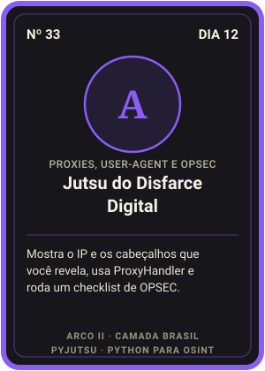 | 33 | A | [Jutsu do Disfarce Digital](dia-12-proxies/br/01_meu_ip.py) | [12](dia-12-proxies/) | Mostra o IP e os cabeçalhos que você revela, usa ProxyHandler e roda um checklist de OPSEC. |
|  | 34 | A | [Jutsu da Lista Ordenada](dia-13-listas/br/02_ordenar_com_acento.py) | [13](dia-13-listas/) | Ordena com acento, tira repetidos mantendo a ordem, faz ranking e compara meses com conjuntos. |
|  | 35 | A | [Jutsu da Sala de Evidências](dia-14-sistema-de-arquivos/br/03_hash_custodia.py) | [14](dia-14-sistema-de-arquivos/) | Varre pastas com pathlib, acha PIX e e-mails em tudo e lacra cada arquivo com SHA-256. |
| 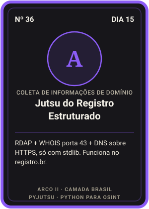 | 36 | A | [Jutsu do Registro Estruturado](dia-15-dominios/br/01_rdap_br.py) | [15](dia-15-dominios/) | RDAP + WHOIS porta 43 + DNS sobre HTTPS, só com stdlib. Funciona no registro.br. |
| 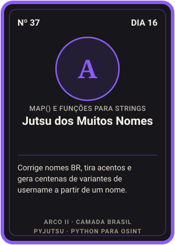 | 37 | A | [Jutsu dos Muitos Nomes](dia-16-map-e-strings/br/03_variantes_username.py) | [16](dia-16-map-e-strings/) | Corrige nomes BR, tira acentos e gera centenas de variantes de username a partir de um nome. |
|  | 38 | A | [Jutsu do Relatório Automático](dia-17-documentos/br/02_relatorio_html.py) | [17](dia-17-documentos/) | Relatório em Markdown, HTML com hashes e CSV para Excel pt-BR, só com stdlib. Bônus: PDF na unha. |
| 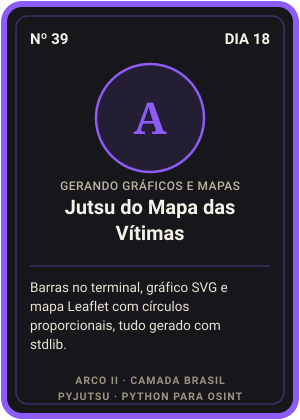 | 39 | A | [Jutsu do Mapa das Vítimas](dia-18-graficos-e-mapas/br/03_mapa_leaflet.py) | [18](dia-18-graficos-e-mapas/) | Barras no terminal, gráfico SVG e mapa Leaflet com círculos proporcionais, tudo gerado com stdlib. |

## Arco III · Mestria

| Carta | Nº | Rank | Nome | Dia | Efeito |
|---|---|---|---|---|---|
| 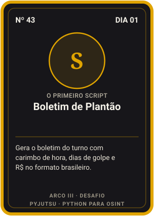 | 43 | S | [Boletim de Plantão](dia-01-primeiro-script/desafio.md) | [01](dia-01-primeiro-script/) | Gera o boletim do turno com carimbo de hora, dias de golpe e R$ no formato brasileiro. |
| 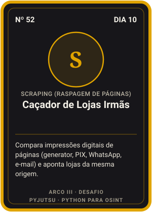 | 52 | S | [Caçador de Lojas Irmãs](dia-10-scraping/desafio.md) | [10](dia-10-scraping/) | Compara impressões digitais de páginas (generator, PIX, WhatsApp, e-mail) e aponta lojas da mesma origem. |
| 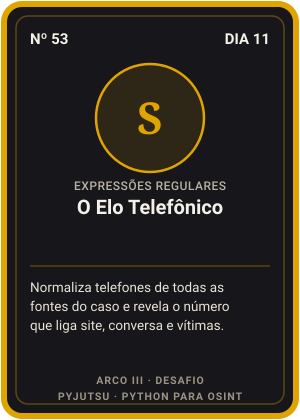 | 53 | S | [O Elo Telefônico](dia-11-regex/desafio.md) | [11](dia-11-regex/) | Normaliza telefones de todas as fontes do caso e revela o número que liga site, conversa e vítimas. |
| 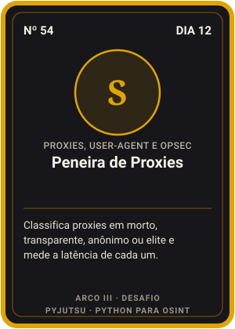 | 54 | S | [Peneira de Proxies](dia-12-proxies/desafio.md) | [12](dia-12-proxies/) | Classifica proxies em morto, transparente, anônimo ou elite e mede a latência de cada um. |
| 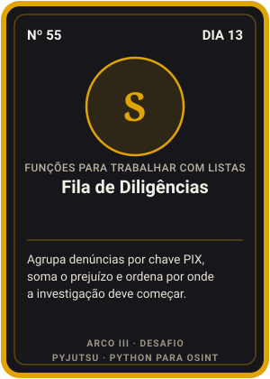 | 55 | S | [Fila de Diligências](dia-13-listas/desafio.md) | [13](dia-13-listas/) | Agrupa denúncias por chave PIX, soma o prejuízo e ordena por onde a investigação deve começar. |
| 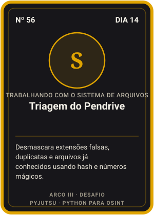 | 56 | S | [Triagem do Pendrive](dia-14-sistema-de-arquivos/desafio.md) | [14](dia-14-sistema-de-arquivos/) | Desmascara extensões falsas, duplicatas e arquivos já conhecidos usando hash e números mágicos. |
| 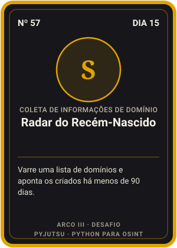 | 57 | S | [Radar do Recém-Nascido](dia-15-dominios/desafio.md) | [15](dia-15-dominios/) | Varre uma lista de domínios e aponta os criados há menos de 90 dias. |
| 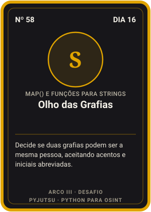 | 58 | S | [Olho das Grafias](dia-16-map-e-strings/desafio.md) | [16](dia-16-map-e-strings/) | Decide se duas grafias podem ser a mesma pessoa, aceitando acentos e iniciais abreviadas. |
| 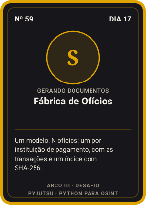 | 59 | S | [Fábrica de Ofícios](dia-17-documentos/desafio.md) | [17](dia-17-documentos/) | Um modelo, N ofícios: um por instituição de pagamento, com as transações e um índice com SHA-256. |
| 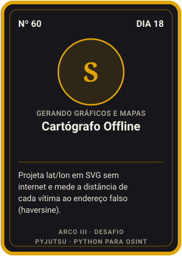 | 60 | S | [Cartógrafo Offline](dia-18-graficos-e-mapas/desafio.md) | [18](dia-18-graficos-e-mapas/) | Projeta lat/lon em SVG sem internet e mede a distância de cada vítima ao endereço falso (haversine). |
